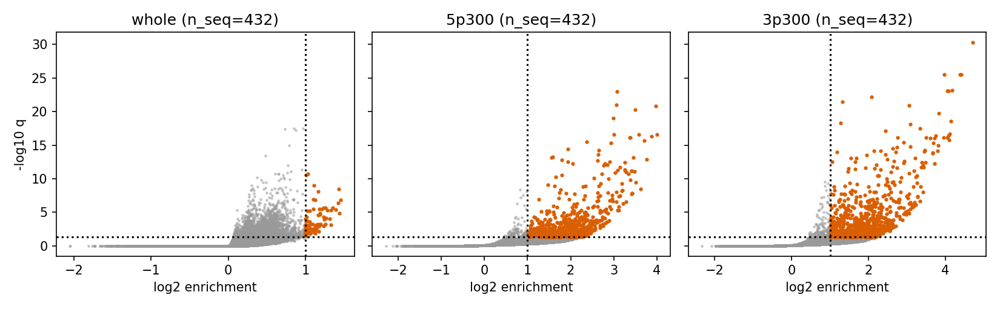
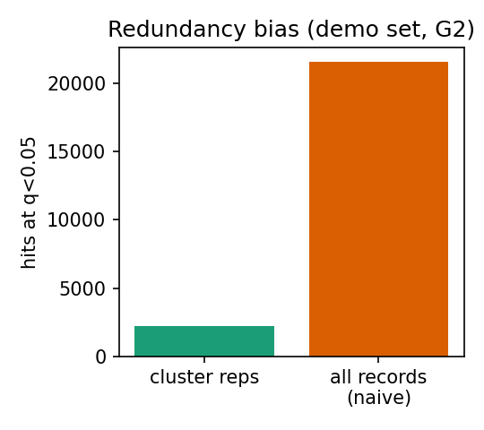
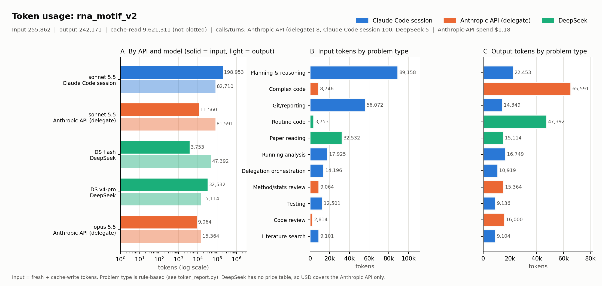

# Viral RNA regulatory-motif discovery (rna_motif_v2)

**Status (2026-11-02, preliminary): pipeline passes its calibration gates and, post hoc, recovers a conserved ~22-nt 3'-UTR element (CCGAGTAGGATCGAGGGTACAG; 25 genomes, astro-, corona-, caliciviruses) that is consistent with the published s2m element. Family-level replication shows real cross-family signal (chain nulls give none); `stat-check` done, 4 open caveats below.**

## Abstract
Question: which short RNA sequence patterns (k=6-8) are over-represented in viral RNA beyond what each genome's own order-2 composition predicts, counting independent sequence clusters rather than records? Approach: NCBI RefSeq pull + QC, similarity clustering, per-sequence Markov-2 background with exact Poisson-binomial tails, BH-FDR within region (whole genome / first 300 nt / last 300 nt). Result: calibration gates pass (1/20 null datasets with any BH hit; planted 8-mer recovered at rank 1, q~1e-134); naive record counting inflates hits 9.6x on a redundant set. On real data 76 whole-genome and ~740-880 terminal-region k-mers are significant, log2 enrichment >=1 and robust to an order-1 background. These are candidates, not functional elements; coding constraint and genus-level homology are not removed (see limitations).

## Workflow (live; ticked = done)
- [x] 0. Papers read and digested ([@bernett2024leakage], [@razumova2025utr], [@jin2025mrna]); rules approved: `reference/golden_standard/SUMMARY.md`
- [x] 1. Spec: `changes/motif-discovery/` (hypothesis, methods v2, tasks). Opus stats review (`handoff/T5.raw.md`) invalidated v1 (shuffle null cannot reach BH thresholds) -> v2
- [x] 2. Task 1 data/QC: `src/fetch_qc.py`, provenance in `data/PROVENANCE.md` (NCBI nuccore Build261031-0025m.1, fetched 2026-11-02)
- [x] 3. Redundancy control: `src/cluster.py` (12-mer Jaccard >= 0.10, orientation to mRNA sense for negative-sense families, low-complexity masking)
- [x] 4. Task 2 motif engine: `src/motif.py` (12 tests pass), run in 6 s on 10 cores
- [x] 5. Gates G1-G3 (`src/gates.py`, `results/gates.json`)
- [x] 6. Real-data analysis (`src/analyze.py`)
- [x] 7. `stat-check` audit + family-level replication (`src/robustness.py`)
- [x] 8. Follow-up of the recurring 3'-end motif: extended element, consistent with s2m (literature check below)
- [ ] 9. Remaining: sequence-level check against an s2m reference alignment (Rfam), genus-level clustering, structure (RNAfold absent)

## Data
469 RefSeq records after QC (12 families, 1000-35,000 nt) + 96 GenBank strains (SARS-CoV-2, Dengue 2, HCV; redundancy demo only). 55 of 620 fetched records dropped (all: >1% non-ACGT). Clustering: RefSeq collapses little (about 1 cluster per record, largest 5), demo collapses strongly (21 -> 1, 75 -> 15 clusters). Only cluster representatives are counted [@bernett2024leakage Q4].

## Methods (choice -> standard)
Order-2 Markov background fitted per sequence; exact Poisson-binomial upper tail on presence across representatives; k=6,7,8; BH within region; effect = log2((obs+0.5)/(expected+0.5)) in units of sequences. Details and rejected alternatives: `changes/motif-discovery/methods.md`. Deviations from the spec during the build: clustering uses 12-mers (8-mers saturate: unrelated 20-30 kb genomes reached Jaccard 0.26 by chance); `expected_sum` reports expected number of sequences with the k-mer (a bug had summed expected counts); G3 passes on q<0.05 and rank<=3.

## Results (preliminary)
**Calibration gates (`results/gates.json`)**

| Gate | Result | Pass |
|---|---|---|
| G1 null calibration: 20 order-2 chain-sampled datasets | BH hits in 1/20 runs (allowed <=1) | yes |
| G2 redundancy bias, demo set (96 records -> 16 reps) | 21,566 hits naive vs 2,235 with representatives (9.6x) | yes (demonstrated) |
| G3 planted GACGTCAG in 20% of reps' first 300 nt | rank 1, q~6e-134, obs 86/432 | yes |

G1 caveat: the null is generated by the same model family as the test (order-2 chains), so it checks implementation and tail accuracy, not fit to real genomes.

**Real data (`results/summary_by_region.tsv`, n=469 representatives, 12 families)**

| region | tests | q<0.05 | + log2enr>=1 | + robust to order-1 | + >=2 families nominal |
|---|---|---|---|---|---|
| whole | 86,011 | 3,057 | 90 | 76 | 84 |
| first 300 nt | 36,854 | 947 | 819 | 742 | 445 |
| last 300 nt | 35,908 | 1,195 | 1,031 | 878 | 735 |



Top candidates after collapsing nested k-mers: `results/top_candidates.tsv`. Examples: 3' end CGAGGGTA / TCGAGGGT / AGGGTACA (overlapping, one ~13-mer ATCGAGGGTACAG, 25-31 reps = 6-7%, 3-4 families, q<1e-19); 5' end poly-U-rich TTTTCTTA (43 reps, 10%, q 1e-23); whole genome GCAGCTGC (110 reps, 25%, 7 families, log2 enr 1.03).

**Known elements, descriptive (`results/known_elements.tsv`, first 300 nt vs 20 chain-sampled nulls)**: PRTE-like pyrimidine pattern modestly higher (37% vs 30%, z=2.8); TOP, canonical rG4, Kozak not enriched; ATG slightly depleted (z=-2.5). Not recovering host-mRNA elements in viral genomes is uninformative [@razumova2025utr].

**Family-level replication (`results/family_replication.tsv`)**: discovery rerun separately inside each family (n=26-40 each; BH within family and region; log2 enrichment >=1); count of families in which a k-mer is significant.

| data | region | sig in >=1 family | >=2 | >=3 | >=4 |
|---|---|---|---|---|---|
| real | whole | 2,966 | 142 | 20 | 3 |
| real | first 300 | 6,907 | 538 | 59 | 6 |
| real | last 300 | 8,182 | 1,124 | 238 | 72 |
| chain null | whole / first / last | 0 / 38 / 79 | 0 | 0 | 0 |

Cross-family recurrence is not produced by the background model alone. Most recurrent last-300 k-mers are AT-rich (TTTTAAA in 7 families; ATTTTAA, TTATTTT in 6), which could be real AU-rich 3'-UTR signal or the composition difference of terminal vs interior sequence (GC: whole 0.446, last 300 nt 0.432, so the global shift is small). **Local-background re-test** (`src/local_bg.py`, order-1 background fitted on the 300-nt windows themselves): in the last 300 nt the AU-rich k-mers stay significant but weak (TTATTTT q=7e-4, ATTTTAA q=6e-3, TTTTAAA q=9e-3; log2 enrichment ~0.8, i.e. <2x), versus s2m k-mers at q~1e-23 and log2 ~4. At the 5' end they vanish (q>0.75, log2~0). So the AU-rich 3' signal is a modest, 3'-specific effect, not a strong motif; treat as low-priority candidate.

**Sensitivity to sampling and clustering** (`results_coarse/`, `results_spread/`; hits = q<0.05, log2 enrichment >=1):

| Run | whole | first 300 nt | last 300 nt | s2m 8-mers (last 300) |
|---|---|---|---|---|
| Main (Jaccard 0.10, first-40 RefSeq) | 90 | 819 | 1,031 | 3 |
| Coarse clustering (Jaccard 0.005, ~genus/family level) | 27 | 118 | 230 | 3 |
| Spread sampling (40 of 400 per family, seeded every-k-th) | 94 | 658 | 849 | 3 |

Coarser clustering removes ~75-85% of terminal hits (Coronaviridae collapses to one representative), so most of the long tail depends on within-family redundancy and is exploratory. With spread sampling, 53/90, 417/819 and 559/1,031 main-run hits are reproduced (~55-65%); the rest are sample-dependent. Robust under all three runs: the s2m core k-mers.

**Recovered extended element (post hoc, `results/motif_3p_hits.tsv`)**: GAGGGTAC occurs within the last 300 nt of 26 representatives (Astroviridae 16, Coronaviridae 8, Caliciviridae 1, Bunyavirales 1), 85-200 nt from the genome end. Aligning 52-nt windows around the hit gives an identical stretch `CCGAGTAGGATCGAGGGTACAG` (>=70% consensus) across astro-, calici- and coronaviruses. This matches the stem-loop II-like motif (s2m), a conserved 3'-UTR element studied in coronaviruses and astroviruses [@keep2023s2m; @lulla2021sl2]. **Verified at sequence level against Rfam RF00164** (`reference/rfam/RF00164_seed.sto`, 39 seed sequences): 38/39 contain GAGGGTAC and 26/39 contain GATCGAGGGTACAG; the first seed sequences show the same `CCGAGTAGGATCGAGGGTACAG` core. It was identified after seeing the data, so it is a recovery example, not a pre-registered positive control. Importance: it shows the pipeline can surface an experimentally studied element, whereas most other candidates are unvalidated.

**`stat-check` audit**

| Check | Status | Evidence |
|---|---|---|
| Independent units / redundancy [@bernett2024leakage Q4] | follows, partly | cluster representatives; G2 shows 9.6x inflation otherwise. Deviation: clusters only at ~85-90% identity, so effective n < 469 |
| No joint preprocessing across compared sets | follows | background fitted per sequence, no global fitting |
| Multiple testing (general principle #3) | follows | BH within region, n_tests reported; nested/overlapping tests dependent (limitation) |
| Seeds / versions (principle #4) | follows | seed 42; in `run_meta.json`, not in tsv columns (validator warning) |
| Baselines (principle #5) | follows | order-1 sensitivity, naive-vs-cluster, chain null |
| Raw data read-only (principle #6) | follows | `data/raw` untouched; derived files separate |
| Calibration on real data | deviates | ~20% of all tests have p<0.1; real genomes depart strongly from Markov-2 (coding, structure), so q-values are not literal error rates; cross-family replication is the safeguard |
| Sampling | deviates | RefSeq records taken in esearch order (first 40 per family), not random: selection bias possible |
| Thresholds (log2>=1, obs>=3, cluster J>=0.10) | no standard covers | project defaults, flagged for user decision |



## Discussion and limitations
- **Candidate vs validated:** a validated element has experimental support (reporter/SHAPE/mutagenesis, conservation with covariation); our candidates are statistical over-representation relative to a composition model. They may reflect phylogeny, coding/codon constraints or structure, not function [@razumova2025utr s4.4].
- The thousands of terminal-region hits are far above what a clean motif signal would give; the background is fitted on the whole genome, so any positional composition difference (UTR vs ORF start, poly-U tracts) counts as enrichment. Treat whole-genome hits as coding-confounded.
- Clusters at ~85-90% identity: genus-level homology (60-85% identity) is not removed, so effective n is nearer the number of genera/families than 469. The recurring 3'-end family could be one clade's conserved sequence.
- Not done: structure (RNAfold not installed). Genus-level clustering and spread sampling done (see sensitivity table).
- Falsifier of the 3'-end family: absence in independent same-family genomes held out of discovery, or disappearance after genus-level clustering.

## Next steps
1) RNAfold structure of the s2m windows (needs install); 2) intersect hits across all three runs for a final robust list structure of the s2m windows.

## Reproducibility
```
python3 src/fetch_qc.py --out data --per-family 40 --demo-n 50   # ~1 min, network
python3 src/cluster.py --qc data/qc
python3 src/run_pipeline.py --out results                         # 6 s
python3 src/gates.py --out results --n-null 20                    # 110 s
python3 src/analyze.py                                            # 10 s
python3 src/robustness.py                                         # ~1 min
pytest tests/
```
Seed 42; Python 3.12, numpy/scipy/pandas; total compute well under 5 min on 10 cores.

## Resource use


Tokens by API, model and problem type (`results/token_usage.tsv`; made with the global `token-report` skill, problem types are rule-based). Most output tokens went to complex-code delegation (Sonnet via API) and routine code (DeepSeek flash); the Claude Code session itself spent most input on planning and reporting. Cache reads (~9.6 M) are not plotted. Anthropic-API spend: $1.18; DeepSeek has no price table.

## References
`reference/literature/library.bib`: [@bernett2024leakage], [@razumova2025utr], [@jin2025mrna], [@keep2023s2m], [@lulla2021sl2].

<details><summary>Changelog</summary>

- 2026-11-02: repo, papers, spec v1->v2 (Opus review), data, pipeline, gates, first results.
- 2026-11-02: stat-check, family-level replication, 3'-end element consistent with s2m.
- 2026-11-02: s2m verified vs Rfam RF00164; local-background test of AU-rich 3' k-mers (weak, <2x).
- 2026-11-02: genus-level clustering and spread-sampling sensitivity runs.
</details>
